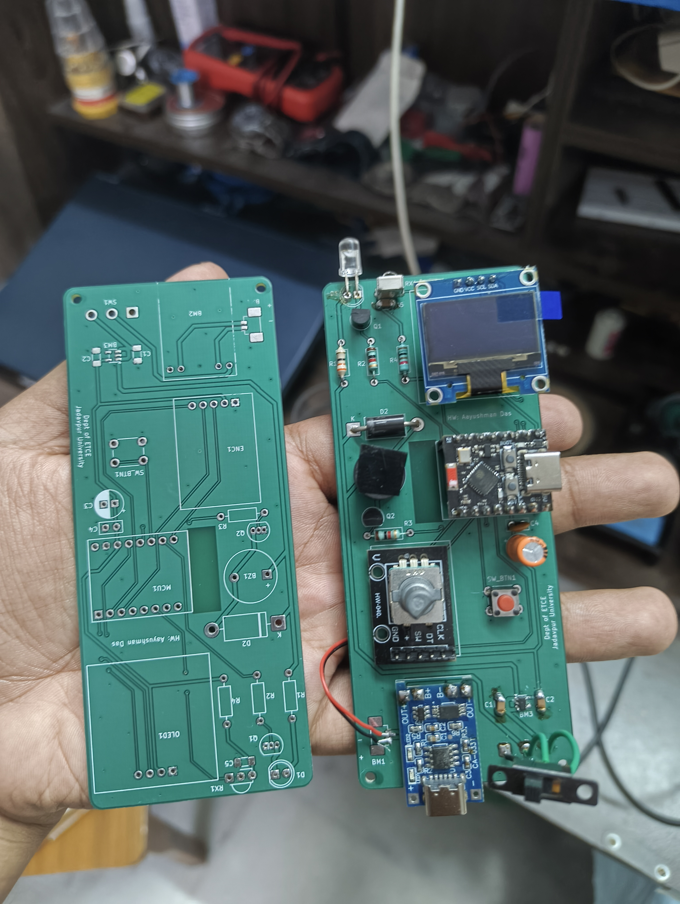

# LucidAC: Smart Universal AC Controller & IR Protocol Sniffer

An open-source, handheld, state-machine-driven universal air conditioner remote and IR protocol analyzer built on the ESP32-C3. Designed for multi-vendor AC control with an intuitive rotary UI, live feedback, and a transparent aesthetic enclosure.



---

## Features

- **State-Driven AC Control:** Implements full multi-byte payload serialization across major manufacturers (Daikin, Carrier, Midea, etc.) rather than simple stateless toggles.
- **Physical Rotary Interface:** Smooth navigation and mode scrubbing via an EC11 rotary encoder paired with a 0.96" SSD1306 I2C OLED display.
- **Live IR Learning & Sniffing:** Integrated TSOP1838 receiver enables on-the-fly packet sniffing and timing inspection without an external logic analyzer.
- **Efficient Power Architecture:** 1S LiPo powered with onboard TP4056 USB-C charging (tuned to ~440mA via custom R_PROG), regulated by an ultra-low-dropout ME6211 3.3V LDO.
- **Light Sleep Wake Engine:** Instantaneous sub-millisecond wakeup on encoder movement and push-button interrupts while conserving battery life.
- **Exposed Aesthetic Enclosure:** Custom 3D-printed chassis with a slide-in acrylic window designed to showcase the PCB layout and passives.

---

## Hardware Architecture

| Subsystem | Component | Notes |
| :--- | :--- | :--- |
| **MCU** | ESP32-C3 SuperMini | Socketed via berg headers for safe, isolated flashing |
| **Display** | 0.96" I2C OLED (SSD1306) | Controlled via `U8g2` with power-save sleep toggling |
| **Input** | EC11 Rotary Encoder + Tactile Switch | Interrupt-driven navigation and wake triggers |
| **Optical TX** | 940nm High-Power IR LED | Driven via switching transistor stage |
| **Optical RX** | TSOP1838 (38kHz) | Demodulated carrier sensing for signal reverse-engineering |
| **Power Management** | TP4056 + DW01A / FS8205A | R_PROG = 2.7kΩ (~440mA CC charge rate) |
| **Rail LDO** | ME6211A33M3G (SOT-23-5) | 500mA rating, low dropout, stabilized with 10µF MLCCs |
| **Audio Feedback** | 3.3V Active Buzzer | Short audible confirmation on transmit and menu clicks |

### Decoupling Strategy
The 3.3V power rail uses a multi-tier decoupling scheme:
- **10µF MLCCs:** Fast loop stability directly at the ME6211 input/output pins.
- **100nF Ceramic:** High-frequency RF and digital switching transient suppression near the MCU.
- **100µF Electrolytic:** Bulk reservoir dampening dynamic load steps from the OLED panel and buzzer bursts.

---

## Pinout Mapping

| Function | ESP32-C3 GPIO | Description |
| :--- | :--- | :--- |
| **I2C SDA** | GPIO 8 | OLED Display Data |
| **I2C SCL** | GPIO 9 | OLED Display Clock |
| **Encoder A (CLK)** | GPIO 4 | Interrupt-driven quadrature input |
| **Encoder B (DT)** | GPIO 5 | Quadrature direction sensing |
| **Encoder SW** | GPIO 3 | Primary selection click |
| **Aux Tactile Switch** | GPIO 2 | Secondary trigger / quick action |
| **IR Transmitter** | GPIO 1 | PWM carrier / protocol modulation |
| **IR Receiver** | GPIO 0 | TSOP1838 demodulated input |
| **Buzzer** | GPIO 10 | Active piezo drive |

---

## Firmware Setup

The firmware is developed using **PlatformIO**.

1. Clone this repository:
   ```bash
   git clone [https://github.com/AayushmanDas/LucidAC.git](https://github.com/AayushmanDas/LucidAC.git)
   cd LucidAC/firmware
   ```
2. Open the `firmware/` directory inside VS Code with the PlatformIO extension installed.
3. Build the project:
   ```bash
   pio run
   ```
4. **Flashing Note:** To prevent back-feeding the carrier board's ME6211 regulator, disconnect the SuperMini from its socket headers or power the board normally before plugging in the USB cable.
5. Upload and open the serial monitor:
   ```bash
   pio run -t upload -t monitor
   ```

---

## Mechanical & 3D Printing

- **Enclosure:** Printable without internal supports on standard FDM printers (PLA or PETG, recommended ≥ 4 perimeter walls, 20% infill).
- **Assembly:** Slide the acrylic faceplate into the top guide rails after securing the PCB.

---

## Bill of Materials (BOM)

A complete CSV list of components, footprint packages, and reference designators can be found in [`hardware/BOM.csv`](hardware/BOM.csv).

---

## License

- [MIT License](LICENSE)
